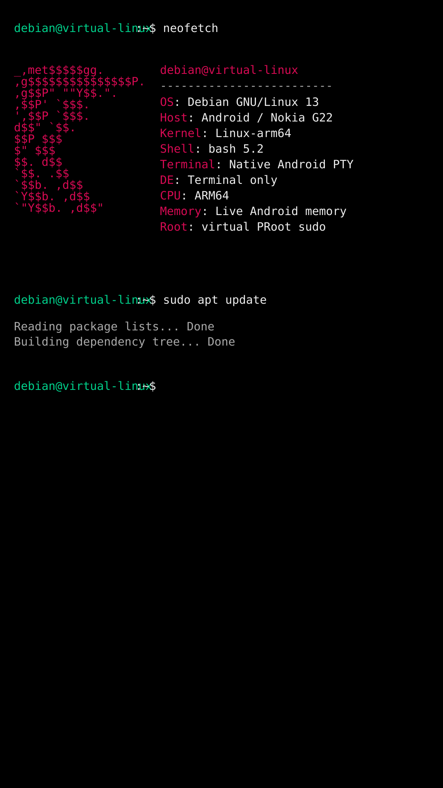

# Virtual-Linux

<p align="center">
  
</p>

<p align="center">
  <strong>A fast, native, terminal-only Debian 13 environment for Android.</strong><br>
  No desktop. No WebView. No Android root required.
</p>

<p align="center">
  <a href="https://github.com/kalilinux123456789az-ai/virtual-linux/releases"><strong>Download APK / Releases</strong></a>
  · <a href="#install">Install</a>
  · <a href="#build-from-source">Build</a>
  · <a href="#frequently-asked-questions">FAQ</a>
</p>

## Features

- Real Debian 13 Bash terminal for ARM64 and x86_64 Android.
- Native Android terminal emulator and pseudo-terminal (PTY).
- Regular `debian` user; virtual root is available through `sudo`.
- Persistent Bash history and 2,000-line scrollback.
- Long-press copy/paste and touch scrolling.
- Volume and pinch controls for terminal font size.
- Foreground service for background terminal operation.
- No desktop, WebView, or Android rooting.
- App-private storage and no permanent wake lock.

> **PRoot is not a security sandbox.** Virtual root is limited to Debian inside the app and does not grant Android root.

## Install

### APK install

1. Open the GitHub **Releases** page.
2. Download the newest `Virtual-Linux.apk`.
3. Open the APK in Android.
4. Approve installation from the browser or file manager if prompted.
5. Open **Virtual-Linux** and wait for first-time Debian setup.
6. Use the `debian@virtual-linux` Bash prompt.

### Install with ADB

```sh
adb install -r Virtual-Linux.apk
```

ADB is optional. Android may require **Install unknown apps** permission for the app that opens the APK.

## Requirements

| Requirement | Details |
|---|---|
| Android | 8.0 (API 26) or newer |
| CPU | ARM64 or x86_64 |
| Storage | At least 180 MB free for setup |
| Network | Needed for x86_64 setup and package downloads |

## What you can do

```sh
sudo apt update
sudo apt install htop neofetch git build-essential python3 python3-pip vim
neofetch
htop
python3 --version
gcc --version
git --version
```

Virtual root is inside Debian only:

```sh
sudo apt update
sudo apt upgrade
sudo -i
```

## Terminal controls

| Action | Control |
|---|---|
| Copy/paste | Long-press terminal text |
| Scroll | Drag or use the terminal scrollbar |
| Font size | Volume up/down or pinch zoom |
| History | Bash `history` or up/down arrows |
| Virtual root | `sudo <command>` or `sudo -i` |
| Stop terminal | Notification **Stop** action |

## Storage and limits

Debian is stored in Android app-private storage. Available phone storage determines how much Debian, packages and files can grow. Clear app data or uninstall to remove Debian.

Android limits direct access to some global `/proc`, process and hardware data. The app supplies compatibility files for tools such as `htop`; memory values are live, while CPU counters and process visibility are approximate.

## Frequently asked questions

### Does it require a rooted phone?

No. It uses PRoot and a normal Android app process.

### Does `sudo` need an Android password?

No. `sudo` grants virtual root inside Debian only.

### Is this a desktop environment?

No. It opens directly into Bash.

### Does it use WebView or xterm.js?

No. It uses the native Android terminal view and emulator with a Debian PTY.

### Can it run htop, gcc, pip and apt?

Yes, subject to Android's normal permission restrictions. Debian packages can be installed with `sudo apt`.

## Build from source

Requirements:

- Linux or macOS
- Android SDK API 35 and Build Tools 35.0.0
- JDK 21 or another JDK providing `javac` and `keytool`

```sh
ANDROID_SDK_ROOT="$HOME/Android/Sdk" ./build.sh
```

The signed APK is written to `app/build/outputs/apk/Virtual-Linux.apk`.

The build script creates a local debug keystore; use a separate release keystore for store distribution.

## Troubleshooting

- **Setup cannot finish:** keep at least 180 MB free and restart setup.
- **Copy/paste:** long-press terminal text and use Android selection controls.
- **Slow terminal:** reduce font size with volume down or pinch zoom.
- **Permission error:** use `sudo` only for Debian operations.
- **App stops in background:** allow Virtual-Linux in Android battery settings.
- **Package list old:** run `sudo apt update`.

## Project layout

```text
app/src/main/java/com/virtuallinux/  Android activity and foreground service
app/src/main/java/com/termux/        Native terminal emulator and view
app/src/main/assets/rootfs/          ARM64 Debian root filesystem
app/src/main/assets/runtime/         PRoot ARM64/x86_64 runtimes
app/src/main/res/                    Android icons and resources
docs/screenshot.svg                  Terminal example image
build.sh                             APK build and verification script
THIRD_PARTY_NOTICES.txt              Dependencies and licenses
```

## Dependencies and licenses

Debian and third-party components keep their upstream licenses. Sources and license texts are recorded in [THIRD_PARTY_NOTICES.txt](THIRD_PARTY_NOTICES.txt).
